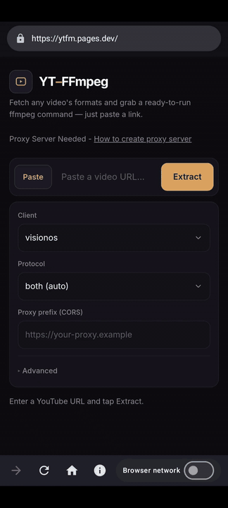
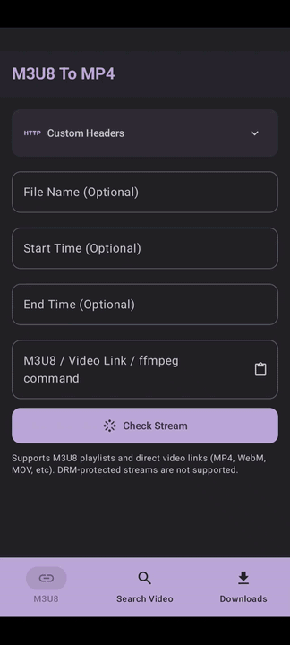

# Best and Safest Way to Download YouTube Videos on Android for Free

Looking for youtube video downloader? Here, you will learn a method to download videos from YouTube on Android in any resolution.

Follow the steps in order to download videos from youtube on your android device.

## 1. Install & open the CORS Tester app

Here is the CORS Tester app link - [Google PlayStore](https://play.google.com/store/apps/details?id=dev.pages.chunkapps.fetchlabcorstester)

1. In the CORS Tester open `https://ytfm.pages.dev`.
2. Enable the `App Network`.
3. Enter YouTube Video URL and click Extract.
4. Copy the ffmpeg command corresponding to the resolution in which you wish to download.

## 2. Install & open the HLS to MP4 Downloader app

Here is the HLS to MP4 Downloader app link - [Google PlayStore](https://play.google.com/store/apps/details?id=dev.pages.m3u8mp4downloader2)

1. Now **paste the ffmpeg command** that you have copied.
2. click on the `Check Stream`
3. Download the Video
